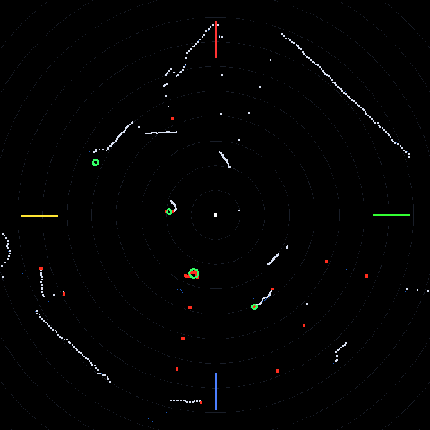
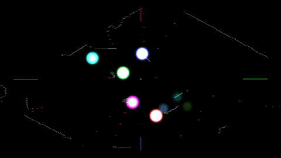

# RPLIDAR A1 / A2 / A3 w TouchDesignerze

Sterownik lidaru 2D zamknięty w jednym `.tox`: skan 512 kubełków, nauka tła,
wykrywanie i śledzenie ludzi, OSC. Cały kod siedzi w DAT-ach komponentu,
z portem COM gada przez `kernel32` (osadzony Python TD nie ma pyserial).

| Widok z góry | Demo |
|---|---|
|  |  |

Biały – skan na żywo, niebieski – nauczone tło, czerwony – obiekty,
zielone kółka – śledzone bloby.

## Wymagania

- Windows 10/11, bez praw administratora
- RPLIDAR A1 / A2 / A3 z przejściówką USB Slamteca
- kabel USB z żyłami danych
- [TouchDesigner](https://derivative.ca/download) 2022.20000+ (testowane na 2025.32460)

A1 i S1 zwykle potrzebują osobnego zasilania 5 V — z samego USB silnik kręci się
za wolno albo wcale. A2 i A3 wyrabiają z portu.

## Start

1. **Code → Download ZIP**, rozpakuj.
2. Podłącz lidar — głowica powinna ruszyć.
3. `INSTALUJ.bat` — sprawdza sterownik przejściówki, znajduje port COM, robi skróty
   na pulpicie. Nic nie ląduje w systemie, bez `pip` i `venv`.
4. Otwórz `td\RPLidar.toe`.
5. Wyjdź z zasięgu czujnika i pulsnij **Naucz tło** (3 s pustego pokoju). Dopóki tego
   nie zrobisz, obiektem jest każda ściana.

Stan sterownika na żywo: DAT `status` w komponencie.

```
DZIALA  port COM10  tryb express
obroty: 445 rpm   obrotow: 118   probek: 63936   bledow: 0
czujnik: RPLIDAR A2M8 / A2, firmware 1.27, hardware 5
```

Tło siedzi w DAT-cie `bg_data` i zapisuje się razem z projektem. Po przestawieniu
czujnika albo przemeblowaniu — naucz od nowa.

## Komponent `rplidar`

`td\rplidar.tox` jest samowystarczalny, przeciągnij go do swojego projektu.

### Wyjścia

| Operator | Zawartość |
|---|---|
| `scan` | CHOP, kanał `dist`: 512 kubełków odległości w mm, kubełek `k` = kąt `k · 360/512`, `0` = brak odbicia |
| `objects` | CHOP, próbka na slot: `active id x y dist angle width age speed`. `x`, `y` w metrach, `x` w prawo, `y` do przodu czujnika |
| `info` | CHOP: `ok rpm revs samples errors objects points background learning` |
| `view` | TOP 720×720, widok z góry |
| `cloud` | TOP 512×1 RGBA32F: `R`=x[m] `G`=y[m] `B`=odległość[m] `A`=1 odbicie / 2 obiekt |
| `objdata` | TOP *Slots*×1 RGBA32F: `R`=x[m] `G`=y[m] `B`=szerokość[m] `A`=1 gdy slot zajęty |
| `status` | DAT ze stanem sterownika |
| `oscout` | wysyła kanały `objects` po OSC, gdy zaznaczysz *Wysyłaj OSC*; adresy = nazwy kanałów |

### Parametry — Lidar

| Parametr | Działanie |
|---|---|
| **Active** | wyłączenie zwalnia port COM |
| **Port COM** | `auto` albo wpisany na sztywno, np. `COM10` |
| **Znajdź port** | przeszukuje porty i wpisuje znaleziony |
| **Obroty silnika (PWM)** | 0–1023, domyślnie 400 ≈ 450 rpm (fabryczne 660 ≈ 810 rpm) |
| **Skan express** | 4000 próbek/s; gdy czujnik nie wspiera, sterownik spada do zwykłego |
| **Restart sterownika** | zamyka i otwiera port od nowa |

### Parametry — Tlo i obiekty

| Parametr | Działanie |
|---|---|
| **Naucz tło** / **Wyczyść tło** | 3 s nauki pustego pomieszczenia / powrót do stanu bez tła |
| **Używaj tła** | wyłączone = obiektem jest wszystko w zasięgu |
| **Margines tła** | o ile mm bliżej niż tło musi coś być, żeby liczyło się jako nowe. Za mało → ściany migoczą, za dużo → człowiek przy ścianie znika |
| **Zasięg min / max** | odcina odbicia od obudowy i z drugiego końca sali |
| **Min. / max. szerokość obiektu** | w kubełkach; min 3 odsiewa zgubione próbki, max 80 odsiewa całą ścianę |
| **Dopuszczalna dziura** | ile pustych kubełków wolno przeskoczyć, sklejając jeden obiekt |
| **Głębokość przedniej powierzchni** | liczy się tylko to, co najbliżej; inaczej środek obiektu wędruje po ramieniu |

**Sledzenie**: `Slots` (ile obiektów naraz), `Max. przeskok` (ile metrów obiekt może
przeskoczyć i wciąż być sobą), `Zwolnienie numeru po`, `Wygładzanie`.
**Widok**: zasięg, rysowanie tła i kółek. **OSC**: adres i port odbiorcy.

## Obroty a rozdzielczość

Lidar wypuszcza stałe 4000 próbek/s niezależnie od obrotów, więc wolniejsza głowica
daje więcej próbek na obrót:

| Obroty | Próbek na obrót | Rozdzielczość |
|---|---|---|
| 810 rpm — PWM 660, fabrycznie | ~296 | 1,2° |
| 450 rpm — PWM 400, domyślne tutaj | ~540 | 0,67° |

Stąd 512 kubełków. Przy 810 rpm dłoń z dwóch metrów to jedna–dwie próbki, nie do
odróżnienia od szumu. Kosztem jest 7,5 obrotu na sekundę zamiast 13,5 — przy bardzo
szybkim ruchu warto podnieść PWM.

## Zastosowania

- Pozycje ludzi: `objects` → `x`, `y`; `info/objects` = ilu w kadrze.
- Ściana dotykowa: lidar płasko na ścianie, kilka cm przed płaszczyzną projekcji.
  Dłoń wchodzi w płaszczyznę skanu. Kalibrację lidar↔projektor trzeba dorobić.
- Bramka / licznik przejść: wąski wycinek kąta + `age` i `speed`.
- Własna grafika: `cloud` jako źródło instancji, `objdata` w swoim GLSL-u —
  tak zrobione jest demo (`td/src/demo.frag`, 40 linii).

## Diagnostyka bez TouchDesignera

`sprawdz-lidar.bat` — czysty PowerShell: porty COM, model, firmware, health,
4 s odbioru z pokryciem kąta. Port COM jest na wyłączność, więc najpierw odznacz
**Active** albo zamknij TD.

```powershell
powershell -ExecutionPolicy Bypass -File scripts\test-lidar.ps1 -Port COM7 -Seconds 10
powershell -ExecutionPolicy Bypass -File scripts\find-port.ps1
```

## Problemy

| Objaw | Przyczyna |
|---|---|
| `status`: BRAK POLACZENIA, głowica się kręci | Port trzyma drugi TouchDesigner albo otwarta diagnostyka |
| Brak jakiegokolwiek portu COM | Brak sterownika przejściówki: [CP210x](https://www.silabs.com/developer-tools/usb-to-uart-bridge-vcp-drivers), klony z CH340: [CH341SER](https://www.wch-ic.com/downloads/CH341SER_EXE.html) |
| Port jest, czujnik nie odpowiada | Kabel USB bez żył danych |
| Głowica nie kręci się albo < 200 rpm | Zasilanie: port bezpośrednio w komputerze, hub z zasilaczem, przy A1/S1 osobne 5 V |
| Numer portu zmienił się po przełożeniu USB | Każdy port USB to dla Windows inne urządzenie — zostaw **Port = auto** |
| Obiekty tam, gdzie nikogo nie ma | Kierunki bez odbicia podczas nauki są traktowane jako otwarta przestrzeń. Zmniejsz **Zasięg max** albo zwiększ **Margines tła** |
| Widać tylko wycinek z 360° | Coś zasłania głowicę: taśma, własny kabel, obudowa |
| Czarne, szklane i lustrzane powierzchnie niewidoczne | Fizyka lidaru, do obejścia tylko ustawieniem czujnika |
| Dane zamarzły, obraz płynie dalej | Script CHOP/TOP bez wejścia nigdy nie jest brudny. Komponent gotuje je ręcznie w Execute DAT `exec` — przepisując kod, nie zgub tego |
| TD zapisał projekt „with errors" | Uchwyt portu i Tracker się nie marynują; komponent czyści je w `onProjectPreSave` |
| Po twardym zamknięciu TD głowica dalej kręci | Silnikiem steruje linia DTR przejściówki — wyjmij i włóż USB |

## Protokół

Sprawdzone na A2M8, firmware 1.27, hardware 5.

- **Bit synchronizacji kapsuły w trybie express nie zapala się nigdy.** Obroty liczone
  są z przewinięcia kąta startowego kapsuły.
- Kapsuła express ma 84 B: nagłówek `0xA?` `0x5?`, XOR z 82 bajtów danych, kąt startowy
  (15 bitów), 16 par próbek = 32 próbki.
- Zwykły skan to próbki 5-bajtowe: bit startu i jego negacja muszą się różnić,
  bit 0 drugiego bajtu jest kontrolny.
- Komendy z payloadem (`SET_MOTOR_PWM` 0xF0) mają XOR po **wszystkich** bajtach żądania,
  razem z `0xA5` i bajtem długości.
- Silnik chodzi z linii DTR przejściówki: `DTR = 0` → kręci.

## Implementacja

- Czytanie portu w osobnym wątku, `scan` tylko przepisuje ostatni stan — zatkane
  gotowanie sieci TD nie gubi próbek.
- Jeden trwały pierścień 512 kubełków ze znacznikiem obrotu na każdym, zamiast
  podwójnego bufora. Nie ma szwu na 0°, a kubełek bez odbicia starzeje się i gaśnie.
- Rejestr sterownika w `builtins`: przeładowanie DAT-u albo skasowanie komponentu
  zostawiało wcześniej żywy wątek z otwartym portem, nie do odnalezienia aż do
  restartu TD.
- Port zamyka sam wątek — zamknięcie uchwytu pod działającym wątkiem zostawia go
  w pętli czytania.

## Własny kod

```python
drv = mod('/project1/rplidar/rplidar_driver').acquire(port='auto')
dist = drv.snapshot()          # numpy float32[512], mm, 0.0 = brak odbicia
print(drv.rpm, drv.mode, drv.info)

logic = mod('/project1/rplidar/rplidar_logic')
mask = logic.foreground(dist, bg)          # bg z op('/project1/rplidar').fetch('background')
for b in logic.blobs(mask, dist):
    print(b['x'], b['y'], b['dist'], b['width'])
```

## Przebudowa komponentu

`td\src\` to źródło prawdy, `.tox` to jego spakowana kopia. Po zmianie pliku trzeba
go wczytać z powrotem — TD dalej pracuje na starej wersji i nic nie zgłosi.
W Textporcie (Alt+T):

```python
SRC = r'...\rplidar-windows\td\src'
exec(open(SRC + r'\build_rplidar.py', encoding='utf-8').read(), {'SRC': SRC, 'me': me})
op('/project1/rplidar').save(r'...\rplidar-windows\td\rplidar.tox')
```

## Pliki

| Plik | Do czego |
|---|---|
| `INSTALUJ.bat` / `odinstaluj.bat` | instalacja bez admina / usunięcie skrótów i zapamiętanego portu |
| `sprawdz-lidar.bat` | diagnostyka bez TouchDesignera |
| `znajdz-port.bat` | sama autodetekcja portu |
| `scripts\rplidar.ps1` | protokół RPLIDAR-a w czystym PowerShellu |
| `scripts\find-port.ps1`, `test-lidar.ps1` | autodetekcja i diagnostyka |
| `td\RPLidar.toe` | projekt z komponentem i demem |
| `td\rplidar.tox` | sam komponent |
| `td\src\` | źródła DAT-ów + `build_rplidar.py` |

## Licencja

MIT, patrz [LICENSE](LICENSE). Opis protokołu na podstawie publicznej dokumentacji
Slamteca i `rplidar_sdk` (BSD-2), patrz [THIRD_PARTY_NOTICES.md](THIRD_PARTY_NOTICES.md).
