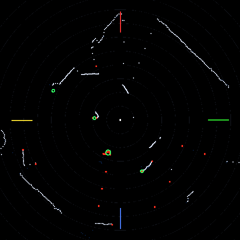
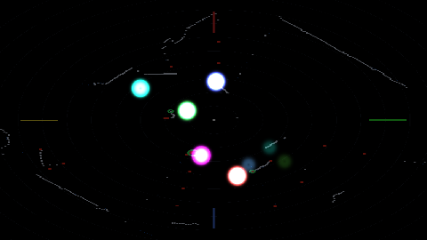

# RPLIDAR w TouchDesignerze na Windows – zestaw dla studentów

Lidar 2D **Slamtec RPLIDAR** (A1 / A2 / A3) podłączony po USB, czytany **bezpośrednio
w TouchDesignerze** – bez Pythona, bez ROS, bez instalowania czegokolwiek w systemie.
Skan na żywo, nauka tła pustego pomieszczenia, wykrywanie i śledzenie ludzi,
wyjście OSC i gotowy projekt do przerabiania.

| Co widzi czujnik | Demo reagujące na ludzi |
|---|---|
|  |  |

*Po lewej: biały – skan na żywo, niebieski – nauczone tło, czerwony – to, czego
w pustym pokoju nie było, zielone kółka – śledzone obiekty.*

---

## Czego potrzebujesz

- Windows 10 lub 11 (64-bit) – **bez praw administratora**
- RPLIDAR A1, A2 albo A3 z przejściówką USB (w zestawie Slamteca)
- kabel USB **z żyłami danych** (nie „tylko do ładowania")
- [TouchDesigner](https://derivative.ca/download) **2022.20000 lub nowszy**
  (darmowa wersja Non-Commercial w zupełności wystarczy; testowane na 2025.32460)
- internet **tylko wtedy**, gdy Windows nie ma jeszcze sterownika przejściówki USB

> **A1 i S1** często potrzebują osobnego zasilania 5 V – sam USB bywa za słaby i silnik
> kręci się za wolno albo wcale. A2 i A3 w zestawie z przejściówką Slamteca zasilają się
> z USB bez problemu.

## Instalacja (2 minuty)

1. **Pobierz paczkę:** zielony przycisk **Code → Download ZIP** na tej stronie.
2. **Rozpakuj** ZIP: prawy klik → *Wyodrębnij wszystko…* → np. do `Dokumenty`.
   Nie uruchamiaj niczego z wnętrza ZIP-a.
3. **Podłącz lidar** do USB. Głowica powinna zacząć się kręcić (słychać szum).
4. Kliknij dwa razy **`INSTALUJ.bat`**.
   - Jeśli pojawi się *„System Windows ochronił ten komputer"*: **Więcej informacji → Uruchom mimo to**.
   - Nie pojawi się okno UAC – ta paczka nie potrzebuje administratora.
5. Instalator sprawdzi sterownik przejściówki, znajdzie port COM lidaru, sprawdzi
   TouchDesignera i zrobi skróty na pulpicie.
6. Otwórz **`td\RPLidar.toe`** (albo skrót *„RPLIDAR – projekt TouchDesigner"*).

To wszystko. Żadnego `pip`, żadnego `venv`, nic nie ląduje w systemie.

## Pierwsze uruchomienie

Po otwarciu projektu kliknij na komponent **`rplidar`** i spójrz na DAT **`status`**
w środku – to jedyne miejsce, do którego warto zaglądać, gdy coś nie działa.
Powinno być:

```
DZIALA  port COM10  tryb express
stan sterownika: skanuje
obroty: 445 rpm   obrotow: 118   probek: 63936   bledow: 0
czujnik: RPLIDAR A2M8 / A2, firmware 1.27, hardware 5

TLO: nie nauczone - wszystko w zasiegu jest "obiektem".
```

Teraz **wyjdź z zasięgu czujnika** i pulsnij **„Naucz tło"** (strona *Tlo i obiekty*).
Przez 3 sekundy komponent zapamiętuje, jak wygląda puste pomieszczenie. Od tej chwili
„obiektem" jest tylko to, czego w nim nie było – czyli ludzie.

Tło zapisuje się razem z projektem (siedzi w DAT-cie `bg_data`), ale **po przestawieniu
czujnika albo przemeblowaniu trzeba nauczyć je od nowa** – zapisane tło nie wie
o przeprowadzce.

## Komponent `rplidar`

Przeciągnij **`td\rplidar.tox`** do własnego projektu i masz wszystko poniżej.
Komponent jest samowystarczalny – cały kod siedzi w DAT-ach w środku.

### Co z niego wychodzi

| Operator | Co daje |
|---|---|
| `scan` | CHOP, kanał `dist`: **512 kubełków** odległości w mm, kubełek `k` = kąt `k · 360/512`, `0` = brak odbicia |
| `objects` | CHOP, próbka na slot: `active id x y dist angle width age speed`. `x`,`y` w **metrach**, `x` w prawo, `y` do przodu czujnika |
| `info` | CHOP: `ok rpm revs samples errors objects points background learning` |
| `view` | TOP 720×720: widok z góry (ten ze zrzutu wyżej) |
| `cloud` | TOP 512×1 RGBA32F: `R`=x[m] `G`=y[m] `B`=odległość[m] `A`=1 odbicie / 2 obiekt – gotowe pod instancing i GLSL |
| `objdata` | TOP *Slots*×1 RGBA32F: `R`=x[m] `G`=y[m] `B`=szerokość[m] `A`=1 gdy slot zajęty |
| `status` | DAT: stan czujnika po polsku |
| `oscout` | wysyła `objects` po OSC, gdy zaznaczysz *Wysyłaj OSC* |

### Parametry

**Lidar**

| Parametr | Co robi |
|---|---|
| **Active** | wyłączenie zwalnia port COM – przydatne, gdy chcesz uruchomić `sprawdz-lidar.bat` |
| **Port COM** | `auto` = szukaj sam (zalecane). Można wpisać `COM10` na sztywno |
| **Znajdź port** | przeszukuje porty i wpisuje znaleziony |
| **Obroty silnika (PWM)** | 0–1023. **400 ≈ 450 rpm** i to jest celowo wolniej niż fabrycznie (660 ≈ 810 rpm) – patrz niżej |
| **Skan express** | gęstszy tryb (4000 próbek/s). Gdy czujnik go nie wspiera, sterownik sam spada do zwykłego |
| **Restart sterownika** | zamyka i otwiera port od nowa |

**Tlo i obiekty**

| Parametr | Co robi |
|---|---|
| **Naucz tło** | 3 s nauki **pustego** pomieszczenia |
| **Wyczyść tło** | po tym wszystko w zasięgu jest znowu „obiektem" |
| **Używaj tła** | wyłączone = wykrywaj wszystko w zasięgu (dobre do pierwszego sprawdzenia, bezużyteczne w instalacji) |
| **Margines tła** | o ile mm bliżej niż tło musi coś być, żeby liczyło się jako nowe. Za mało → ściany migoczą; za dużo → człowiek przy ścianie znika |
| **Zasięg min / max** | odcina odbicia od obudowy i te z drugiego końca sali |
| **Min. / max. szerokość obiektu** | w kubełkach. Min 3 odsiewa pojedyncze zgubione próbki, max 80 odsiewa „całą ścianę" |
| **Dopuszczalna dziura** | ile pustych kubełków wolno przeskoczyć, sklejając jeden obiekt |
| **Głębokość przedniej powierzchni** | liczy się tylko to, co jest najbliżej – inaczej środek obiektu wędrowałby po całym ramieniu |

**Sledzenie** – `Slots` (ile obiektów naraz), `Max. przeskok` (ile metrów obiekt może
przeskoczyć i wciąż być sobą), `Zwolnienie numeru po` (jak długo trzymać numer, gdy
obiekt zniknął), `Wygładzanie`.

**Widok** – zasięg widoku z góry, czy rysować tło i kółka obiektów.

**OSC** – adres i port odbiorcy. Adresy wiadomości to nazwy kanałów `objects`.

## Pomysły na instalacje

- **Ludzie jako wejście:** naucz tło → `objects` → `x`, `y` sterują dźwiękiem,
  światłem, obrazem. `info/objects` = „ilu ludzi w kadrze".
- **Ściana dotykowa:** powieś lidar **płasko na ścianie**, kilka cm przed płaszczyzną
  projekcji. Dłoń dotykająca ściany wchodzi w płaszczyznę skanu i jest wykrywana jako
  obiekt. Trzeba dorobić kalibrację lidar↔projektor.
- **Bramka / licznik przejść:** wąski wycinek kąta + `age` i `speed` z `objects`.
- **Własny wygląd:** `cloud` jako źródło instancji (512 punktów), `objdata` w swoim
  GLSL-u – tak zrobione jest demo w `RPLidar.toe` (plik `td/src/demo.frag`, 40 linii).

## Diagnostyka bez TouchDesignera

**`sprawdz-lidar.bat`** – czysty PowerShell, działa na świeżym Windowsie, zanim
cokolwiek zainstalujesz. Pokazuje porty COM, model i firmware czujnika, `health`,
a potem przez 4 sekundy liczy próbki, obroty i pokrycie kąta:

```
=== 2/4 Szukam lidaru ===
  [OK] Port: COM10
  [OK] RPLIDAR A2M8 / A2  firmware 1.27, hardware 5

=== 4/4 Odbior danych (4 s) ===
  [OK] probek: 4403 (1419/s), z odbiciem: 2777
  [OK] obrotow: 15, ~432 rpm
  [OK] pokrycie kata: 81% z 360 stopni
       odleglosci: 136 - 4753 mm
```

**Zamknij TouchDesignera, zanim to uruchomisz** – port COM jest na wyłączność.
Alternatywnie odznacz **Active** na komponencie, to też zwalnia port.

## Typowe problemy

| Objaw | Co zrobić |
|---|---|
| `status` mówi „BRAK POLACZENIA", a lidar się kręci | Port trzyma inny program – najczęściej **drugi TouchDesigner** albo otwarty `sprawdz-lidar.bat`. Port COM jest na wyłączność. |
| „Access to the port is denied" w diagnostyce | To samo z drugiej strony: TouchDesigner trzyma port. Odznacz **Active** albo zamknij TD. |
| Brak jakiegokolwiek portu COM | Brak sterownika przejściówki. Windows 10/11 pobiera CP210x sam z Windows Update – podłącz internet, wyjmij i włóż USB, odczekaj minutę. Ręcznie: [CP210x VCP](https://www.silabs.com/developer-tools/usb-to-uart-bridge-vcp-drivers), a dla klonów z CH340: [CH341SER](https://www.wch-ic.com/downloads/CH341SER_EXE.html). |
| Port jest, ale lidar nie odpowiada | Kabel USB bez żył danych (typowy kabel „do ładowania"). Spróbuj innego. |
| Głowica nie kręci się wcale | Za słabe zasilanie z USB. Inny port USB (najlepiej bezpośrednio w komputerze, nie przez hub), hub z własnym zasilaczem, a przy A1/S1 – osobne 5 V. |
| Niskie obroty (< 200 rpm w diagnostyce) | To samo: zasilanie. Przy niskich obrotach skan jest gęstszy, ale poniżej ~200 rpm lidar gubi obroty. |
| Numer portu zmienił się po przełożeniu USB | Dla Windows każdy port USB to inne urządzenie. Zostaw **Port = auto**, albo pulsnij **Znajdź port**. |
| Wszystko jest „obiektem", cały pokój świeci na czerwono | Tło nie jest nauczone. Wyjdź z kadru i pulsnij **Naucz tło**. |
| Po nauce tła nic nie jest wykrywane | Tło nauczone z Tobą w kadrze – stoisz teraz tam, gdzie „zawsze była ściana". Naucz jeszcze raz, przy pustym pomieszczeniu. |
| Obiekty pojawiają się tam, gdzie nikogo nie ma | Kierunki, w których podczas nauki nie było żadnego odbicia, traktowane są jako otwarta przestrzeń – tam **każde** odbicie jest nowe. Zmniejsz **Zasięg max** albo zwiększ **Margines tła**. |
| Lidar widzi tylko wycinek z 360° | Normalne, gdy stoi w kącie albo przy ścianie. Jeśli nie – coś zasłania głowicę: taśma, własny kabel, obudowa. Sprawdź pokrycie w `sprawdz-lidar.bat`. |
| Czarne, szklane albo lustrzane powierzchnie nie są widziane | Tak działa lidar – czarny materiał nie odbija, szkło przepuszcza, lustro odbija w bok. Nie da się tego wyregulować, trzeba to obejść ustawieniem czujnika. |
| Dane w TD zamarzły, obraz płynie dalej | Script CHOP/TOP **bez wejścia nigdy nie jest oznaczany jako brudny**. Komponent gotuje je na piechotę w Execute DAT `exec` – jeśli przepisujesz kod do siebie, nie zgub tego. |
| TouchDesigner zapisał projekt „with errors" | Pamięć operatora jest marynowana do `.toe`, a uchwyt portu i Tracker się nie marynują. Komponent czyści to w `onProjectPreSave` – jeśli przepisujesz kod, przepisz też to. |
| Po zamknięciu TD głowica dalej się kręci | Silnikiem steruje linia DTR przejściówki. Normalnie komponent zatrzymuje go przy wyjściu; po twardym zamknięciu TD wystarczy wyjąć i włożyć USB. |
| TD nie otwiera `.toe` | Za stara wersja. Zaktualizuj albo przeciągnij `td\rplidar.tox` do pustego projektu. |

## Dla zaawansowanych

### Czemu silnik jest zwolniony

Lidar wypuszcza **stałą liczbę próbek na sekundę** (express: 4000/s), niezależnie od
obrotów. Wolniejsza głowica to więcej próbek na obrót, czyli lepsza rozdzielczość kątowa:

| Obroty | Próbek na obrót | Rozdzielczość |
|---|---|---|
| 810 rpm (fabrycznie, PWM 660) | ~296 | 1,2° |
| **450 rpm (PWM 400, domyślne tutaj)** | **~540** | **0,67°** |

0,67° to dokładnie powód, dla którego kubełków jest **512**. Przy fabrycznej prędkości
dłoń z dwóch metrów to jedna–dwie próbki i nie da się jej odróżnić od szumu;
przy 450 rpm to kilka próbek obok siebie, czyli blob. Ceną jest wolniejsze odświeżanie
(7,5 obrotu na sekundę zamiast 13,5) – przy bardzo szybkim ruchu warto PWM podnieść.

### Jak to jest zrobione

- **Bez pyserial.** TouchDesigner ma własnego, osadzonego Pythona bez `pip`, więc
  sterownik rozmawia z portem COM przez `kernel32` (ctypes).
- **Osobny wątek.** Zatkane gotowanie sieci nie może gubić danych skanu, więc czytanie
  portu chodzi w tle, a `scan` tylko przepisuje ostatni stan.
- **Jeden trwały pierścień 512 kubełków** ze znacznikiem obrotu na każdym, zamiast
  podwójnego bufora przepisywanego co obrót. Dzięki temu nie ma szwu na 0°, a kubełek,
  który przestał zwracać odbicie, po prostu się starzeje i gaśnie.
- **Rejestr sterownika w `builtins`.** Przeładowanie DAT-u albo skasowanie komponentu
  zostawiało wcześniej żywy wątek z otwartym portem, o którym nikt już nie wiedział –
  i COM był zablokowany aż do restartu TouchDesignera. Teraz sterownik da się odnaleźć
  i zamknąć zawsze.
- **Wątek zamyka port sam.** Zamknięcie uchwytu pod działającym wątkiem zostawia go
  żywym w pętli czytania – to była dokładnie ta sama awaria.

### Protokół – co odbiega od dokumentacji

Sprawdzone na A2M8, firmware 1.27, hardware 5:

- **Bit synchronizacji kapsuły w trybie express nie zapala się nigdy.** Obroty liczone
  są z przewinięcia kąta początkowego kapsuły.
- Kapsuła express ma **84 bajty**: nagłówek `0xA?` `0x5?`, suma XOR z 82 bajtów danych,
  kąt startowy (15 bitów) i 16 par próbek, czyli 32 próbki na kapsułę.
- Zwykły skan to 5-bajtowe próbki; bit startu i jego negacja muszą się różnić, a bit 0
  drugiego bajtu jest bitem kontrolnym.
- Komendy z payloadem (`SET_MOTOR_PWM` 0xF0) mają sumę **XOR po wszystkich bajtach
  żądania**, razem z `0xA5` i bajtem długości.
- Przejściówka USB steruje silnikiem linią **DTR**: `DTR = 0` → silnik kręci.

### Test z linii poleceń

```powershell
# model, firmware, health, 4 s odbioru
powershell -ExecutionPolicy Bypass -File scripts\test-lidar.ps1

# tylko znalezienie portu (zapisuje go dla TouchDesignera)
powershell -ExecutionPolicy Bypass -File scripts\find-port.ps1

# konkretny port, dłuższy pomiar
powershell -ExecutionPolicy Bypass -File scripts\test-lidar.ps1 -Port COM7 -Seconds 10
```

### Własny kod w TouchDesignerze

```python
drv = mod('/project1/rplidar/rplidar_driver').acquire(port='auto')
dist = drv.snapshot()          # numpy float32[512], mm, 0.0 = brak odbicia
print(drv.rpm, drv.mode, drv.info)

logic = mod('/project1/rplidar/rplidar_logic')
mask = logic.foreground(dist, bg)          # bg z op('/project1/rplidar').fetch('background')
for b in logic.blobs(mask, dist):
    print(b['x'], b['y'], b['dist'], b['width'])
```

### Przebudowa komponentu ze źródeł

Pliki w `td\src\` są **źródłem prawdy**, a `.tox` to ich spakowana kopia. Po zmianie
pliku trzeba go wczytać z powrotem – inaczej TouchDesigner dalej pracuje na starej
wersji i nic tego nie zgłosi:

```python
SRC = r'C:\...\rplidar-windows\td\src'
exec(open(SRC + r'\build_rplidar.py', encoding='utf-8').read(), {'SRC': SRC, 'me': me})
op('/project1/rplidar').save(r'C:\...\rplidar-windows\td\rplidar.tox')
```

## Pliki w paczce

| Plik | Do czego |
|---|---|
| `INSTALUJ.bat` | instalacja (bez administratora) |
| `sprawdz-lidar.bat` | diagnostyka czujnika bez TouchDesignera |
| `znajdz-port.bat` | sama autodetekcja portu |
| `odinstaluj.bat` | usuwa skróty i zapamiętany port |
| `scripts\rplidar.ps1` | protokół RPLIDAR-a w czystym PowerShellu |
| `scripts\find-port.ps1`, `test-lidar.ps1` | autodetekcja i diagnostyka |
| `td\RPLidar.toe` | gotowy projekt z komponentem i demem |
| `td\rplidar.tox` | sam komponent – przeciągnij do swojego projektu |
| `td\src\` | źródła wszystkich DAT-ów + `build_rplidar.py`, który składa komponent |

## Licencja

MIT – patrz [LICENSE](LICENSE). Opis protokołu na podstawie publicznej dokumentacji
Slamteca i `rplidar_sdk` (BSD-2), patrz [THIRD_PARTY_NOTICES.md](THIRD_PARTY_NOTICES.md).
